# Sprout Siege: Zombies in the Garden

[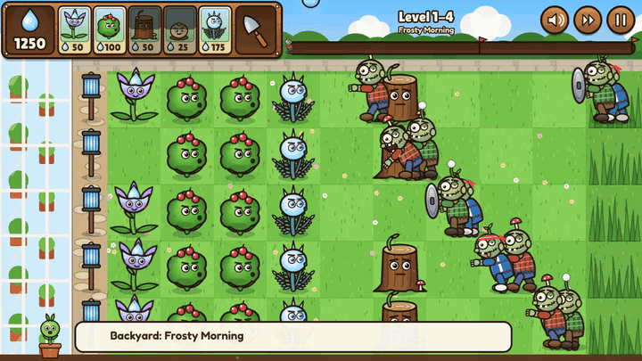](https://sadirhossain0.github.io/sprout-siege/media/videos/Trailer.mp4)

Plant a garden and hold off waves of cartoon zombies before they reach the greenhouse. Free on iPhone, Android, Windows, Mac and the web.

**▶ [Play now in your browser](https://sadirhossain0.github.io/sprout-siege/)** · **[Download for Android, Windows and Mac](https://github.com/sadirhossain0/sprout-siege/releases/latest)** · **[Watch the trailer](https://sadirhossain0.github.io/sprout-siege/media/videos/Trailer.mp4)** · [What's new](CHANGELOG.md)

👾 **New: [Sprout Siege Retro](https://github.com/sadirhossain0/sprout-siege-retro)**, the same game as chunky pixel art with chiptune sound and six color palettes. [Play it in your browser](https://sadirhossain0.github.io/sprout-siege-retro/).

## Features

- **18 plants**, from Dew Lilies and Berry Blasters to Popcorn Pods, Sprinkler Blooms and Boom Gourds
- **15 kinds of cartoon garden zombies** with their own tricks: Joggers change lanes, Brutes stomp your plants dizzy, Parkas freeze them with snowballs, Wheelbarrows bury them, and a crow steals your dew
- **A boss**, the Compost Giant, at the end of every world
- **6 worlds, 60 levels:** Backyard, Autumn Orchard, Moonlit Garden, Frosty Garden, Sunny Beach and Mushroom Grove, each with its own scenery, music and twist, plus rain, thunder and wind
- **Stars** on every level and a new **Daily Challenge** each day
- **Endless Horde** mode for high scores
- Guided tutorial, How to Play book, Watch Demo mode and Field Guide
- **Save codes and save files** to move your progress between devices
- Works offline once it has been opened; all art, music and sound are generated in code

## Screenshots

| | |
|---|---|
| 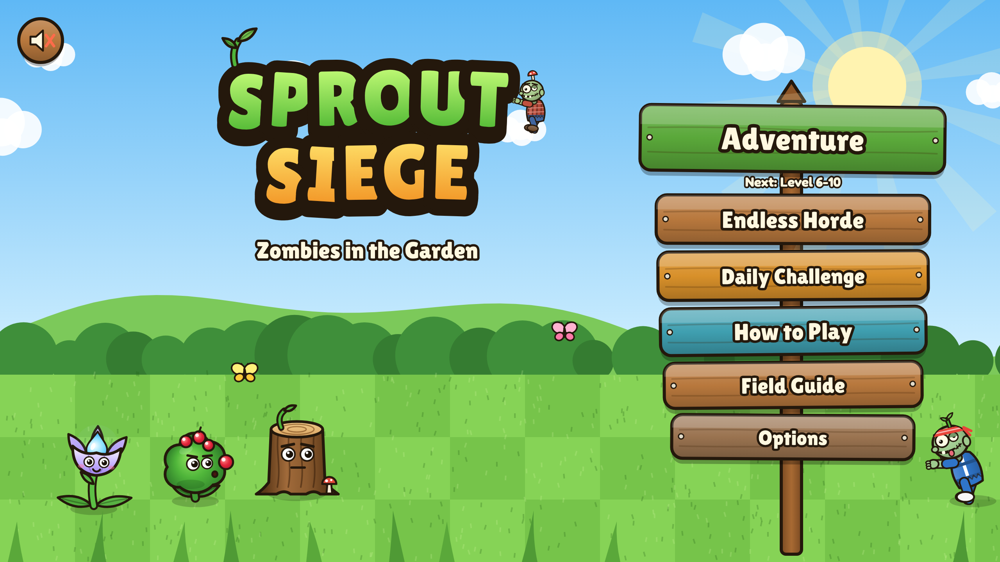 | 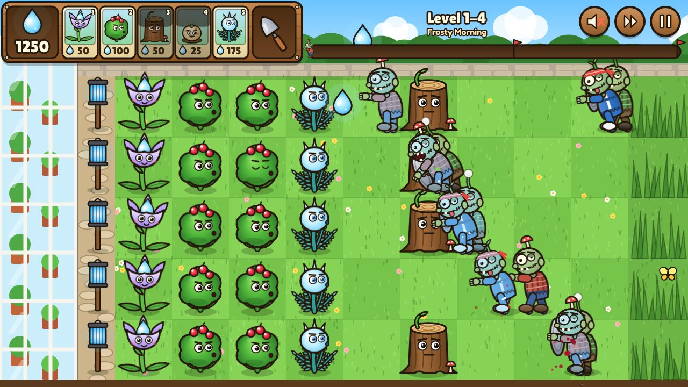 |
| 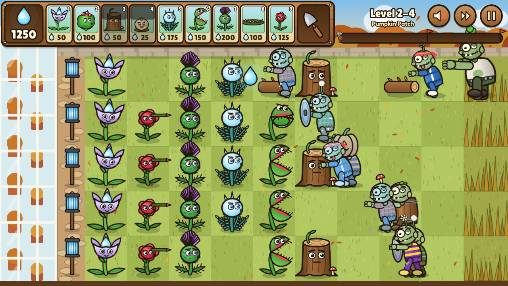 | 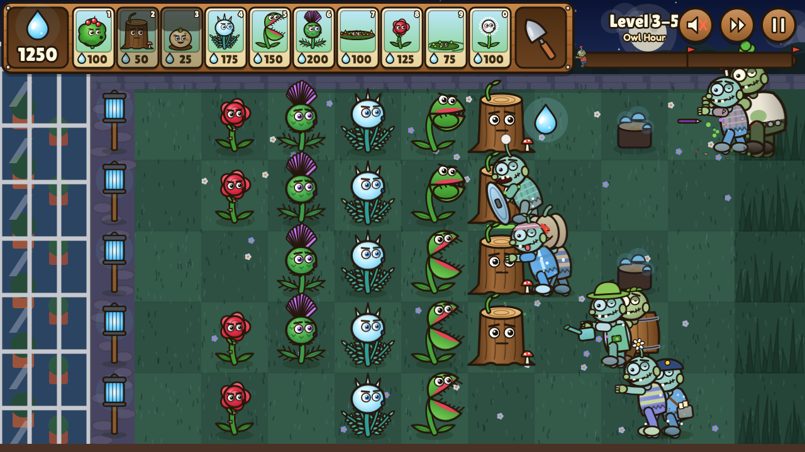 |
| 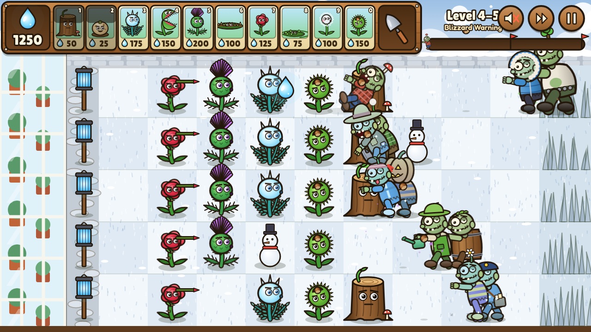 | 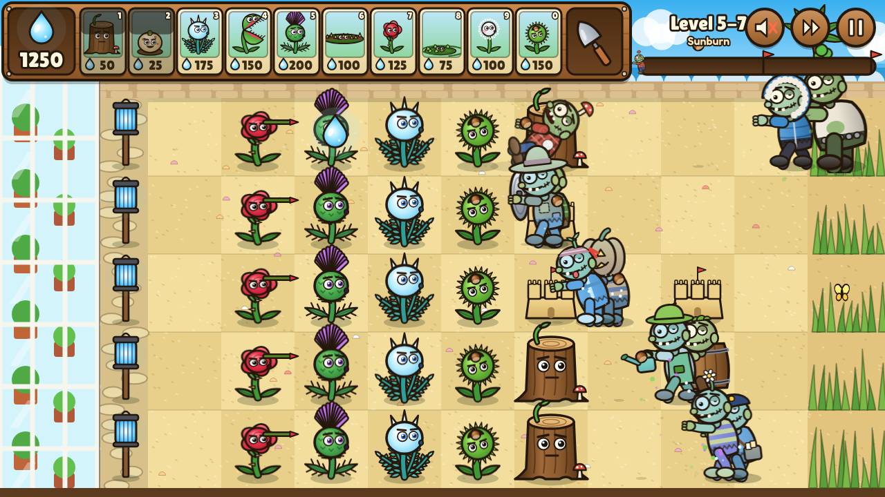 |
| 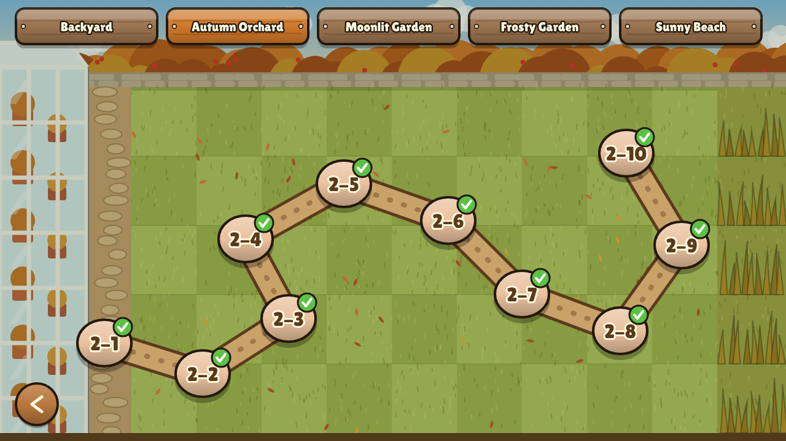 | 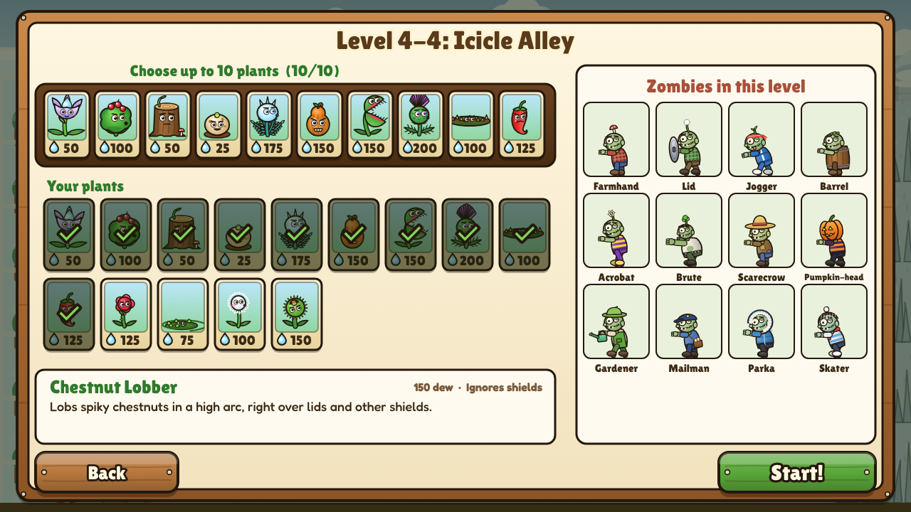 |
| 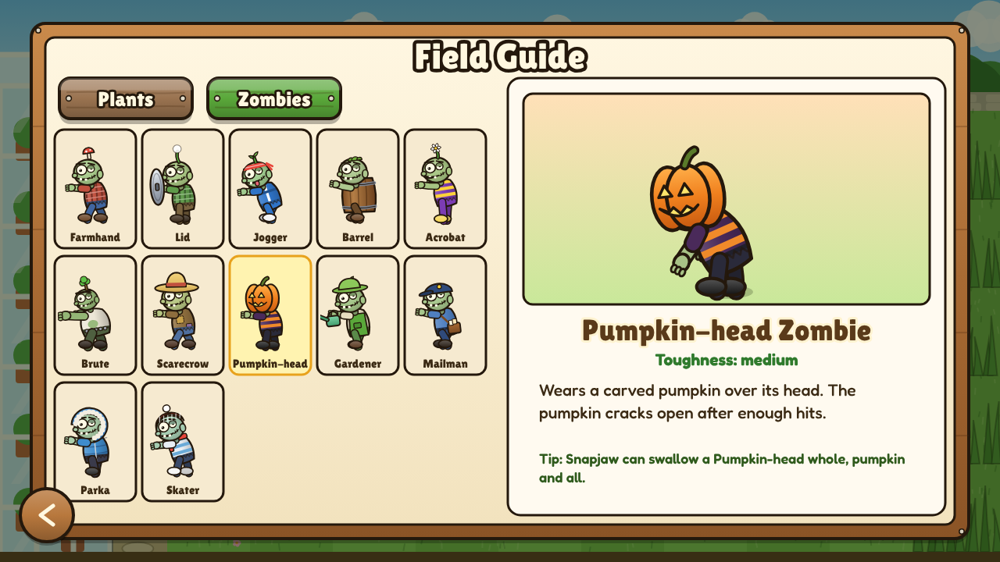 | 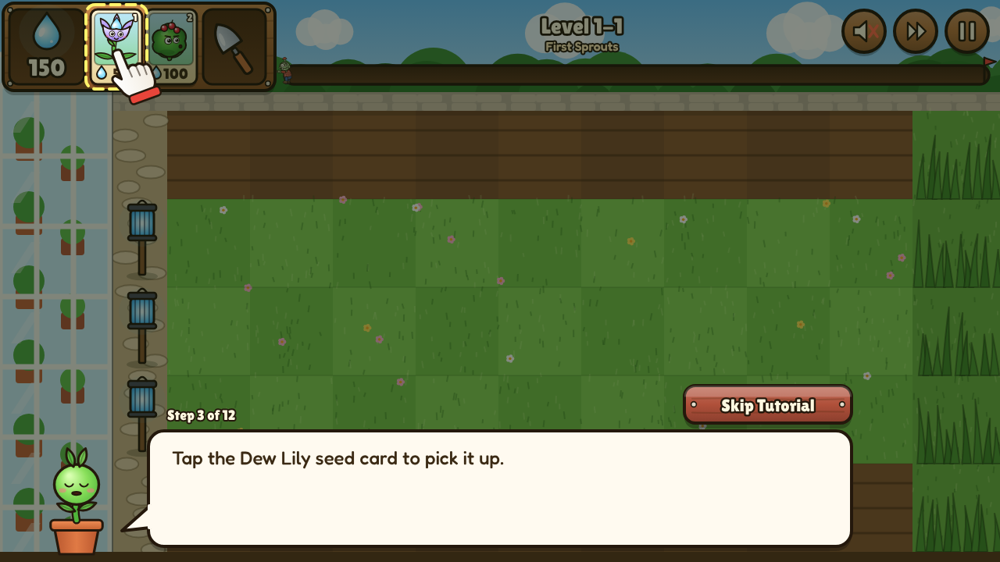 |
| 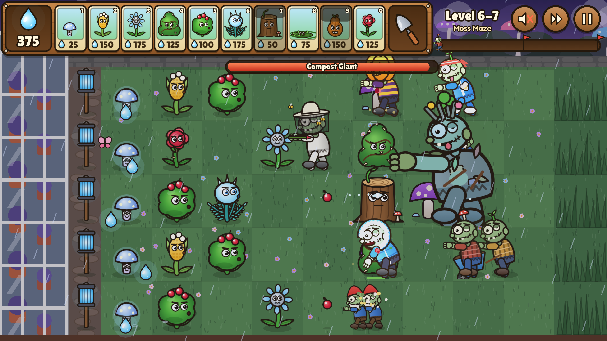 | 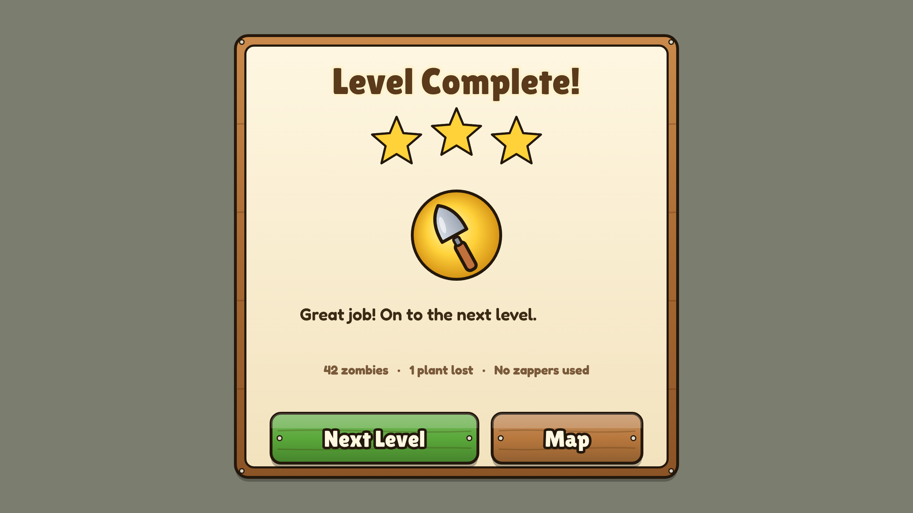 |
| 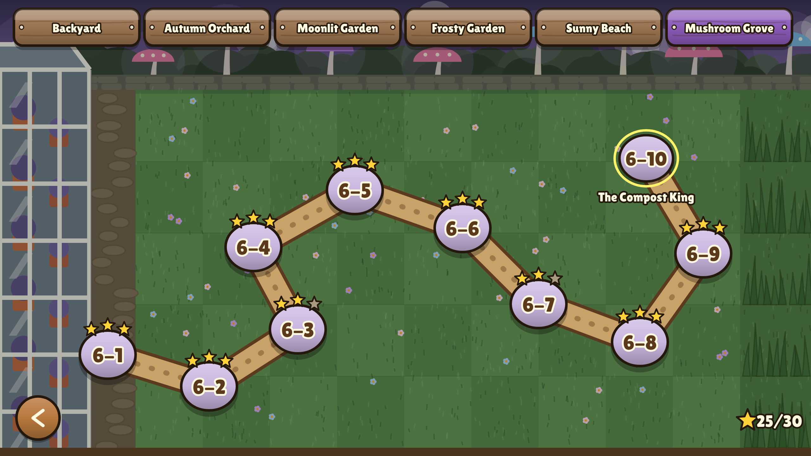 | 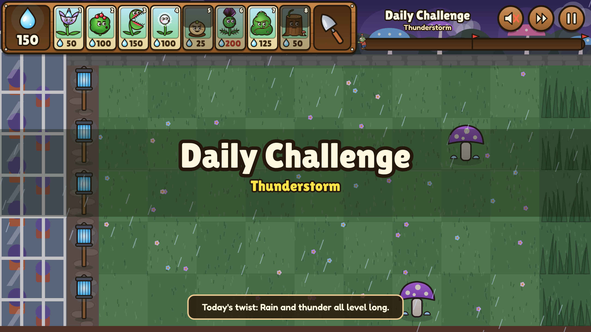 |

## Videos

| Video | What it shows |
|---|---|
| [Trailer](https://sadirhossain0.github.io/sprout-siege/media/videos/Trailer.mp4) | A quick look at all five worlds (45 s) |
| [Getting Started](https://sadirhossain0.github.io/sprout-siege/media/videos/1-Getting-Started.mp4) | Menus and the guided tutorial |
| [Plants, Zombies & Tips](https://sadirhossain0.github.io/sprout-siege/media/videos/2-Plants-Zombies-and-Tips.mp4) | Every page of the How to Play book |
| [Full Level Demo](https://sadirhossain0.github.io/sprout-siege/media/videos/3-Full-Level-Demo.mp4) | A whole level played by the demo bot, with captions |

## Install

| Platform | How |
|---|---|
| **iPhone / iPad** | Open **https://sadirhossain0.github.io/sprout-siege/** in Safari, tap **Share → Add to Home Screen**, and open it once while online. It then works offline, fullscreen. Hold the phone sideways. |
| **Android** | Download the `.apk` from [Releases](https://github.com/sadirhossain0/sprout-siege/releases/latest) and open it. Allow "Install unknown apps"; if Play Protect warns, tap **More details → Install anyway**. |
| **Windows** | Download the Windows `.zip` from [Releases](https://github.com/sadirhossain0/sprout-siege/releases/latest), extract it and run **Sprout Siege.exe**. If SmartScreen appears: **More info → Run anyway**. |
| **Mac** | Download the Apple Silicon or Intel `.zip` from [Releases](https://github.com/sadirhossain0/sprout-siege/releases/latest), drag **Sprout Siege** into Applications and open it. The first time: **System Settings → Privacy & Security → Open Anyway**. |

The security warnings appear because the apps aren't signed with paid developer certificates.

## Controls

- Tap a seed card, then tap a lawn square to plant (or drag the card onto the lawn).
- Hold a finger on a seed card to read what the plant does.
- Tap dew drops (and apples) to collect them.
- Keyboard: `1`–`0` pick cards, `S` trowel, `F` fast-forward, `M` mute, `Esc`/`P` pause.

## Project layout

| Path | What it is |
|---|---|
| `index.html`, `sw.js`, `manifest.webmanifest`, `icons/` | The playable web app served by GitHub Pages |
| `source/web/src/` | Game source (JavaScript; all art and audio drawn or synthesized in code) |
| `source/web/build.py` | Builds the single-file game: `python3 build.py fonts-embed.css` |
| `source/android/` | Android wrapper (`build-apk.sh`, needs Android SDK build-tools 35 and platform 34) |
| `source/desktop/` | Windows and Mac wrapper (Electron; `package-all.sh`) |
| `source/tools/` | Tutorial-video recorder and a Mac `.dmg` helper |
| `.github/workflows/release.yml` | Builds every platform and publishes a release when `release/version.txt` changes |
| `media/` | Screenshots, trailer and tutorial videos |

Fonts: Lilita One and Fredoka, used under the SIL Open Font License 1.1.
